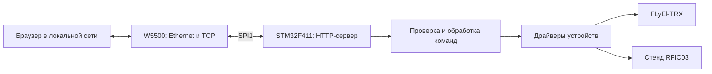

# Архитектура первой версии

Это план реализации. Перечисленные программные модули пока не написаны.

## Разделение ответственности

| Слой | Ответственность |
| --- | --- |
| Плата | Тактирование, GPIO, время, UART диагностики, SPI |
| W5500 | Регистры, память сокетов, статусы соединений, тайм-ауты |
| HTTP | Приём ограниченного запроса, маршрутизация, выдача страницы и ответа |
| Команды | Проверка параметров и доступности устройства |
| Устройство | Конкретный протокол TRX, RFIC03 или другого модуля |

Первая демонстрация должна показывать сетевой статус и выполнять ограниченную
тестовую команду. Управление произвольными GPIO через HTTP не предусматривается:
выводы уже распределены между функциями трансивера.

## Общая SPI1

Дисплей и W5500 имеют отдельные CS. Цепочка 74HC595 получает все такты шины,
поэтому перед защёлкиванием обязательно повторно передаётся полное слово цепочки.
Доступ к общей SPI не должен прерываться транзакцией другого устройства.
Подробности — в [карте выводов](../firmware/PINOUT.md).

## Открытые технические вопросы

- Ревизия Black Pill, наличие дополнительной Flash и подключение кнопки PA0.
- Модель модуля W5500, питание и схема RSTn.
- Число 74HC595, питание логики и допустимая скорость общей шины.
- Протокол и электрический интерфейс RFIC03.
- Формат команд TRX и требования к доступу к веб-интерфейсу.
- Сетевые настройки: статический IP или DHCP.
