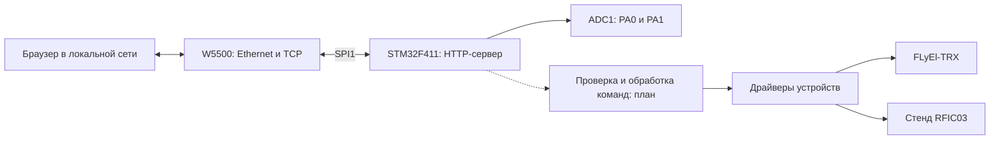

# Архитектура первой версии

В тестовом проекте реализованы плата, W5500 и HTTP-монитор двух каналов АЦП.
Драйверы TRX/RFIC03 и обработка команд управления остаются следующим этапом.

## Разделение ответственности

| Слой | Ответственность |
| --- | --- |
| Плата | Тактирование, GPIO, время, UART диагностики, SPI |
| W5500 | Регистры, память сокетов, статусы соединений, тайм-ауты |
| HTTP | Приём ограниченного запроса, маршрутизация, выдача страницы и ответа |
| Команды | Проверка параметров и доступности устройства |
| Устройство | Конкретный протокол TRX, RFIC03 или другого модуля |

Демонстрация обслуживает `GET /`, `GET /api/adc` и команды LED на TCP-порту 5025.
Ответ содержит `raw`, `mv`, `vref_mv`, `adc_ok`, `link`, `link_speed_mbps`, `sample_ms`,
`sample_count`, `uptime_ms` и `led_on`. Значения `mv` действительны при `adc_ok=true`;
после ошибки ADC коды сохраняются как предыдущая выборка, а страница скрывает их.
Каждый ответ закрывает соединение, используется только socket 0 с RX/TX по 8 Кбайт.
HTTP-заголовок ограничен 1536 байтами, ожидание запроса — 2 с, передача — с тайм-аутом.
DHCP отсутствует, сеть задана в `src/config.h`.
`link_speed_mbps` читается из PHYCFGR W5500: 10/100 при активном линке,
0 при отсутствии линка или ошибке чтения. Поле `link` формируется из той же выборки.

`POST /api/led/on` и `POST /api/led/off` управляют синим светодиодом PC13.
Команды не имеют тела и требуют заголовок `X-Device-Control: 1`.
GET к этим адресам возвращает 405 с `Allow: POST` и не меняет GPIO.
POST с телом, Transfer-Encoding или без обязательного заголовка отклоняется.
Ответ команды — `{"led_on":true}` или `{"led_on":false}`, по значению выходного
регистра GPIO. Это состояние выхода, а не оптическая обратная связь.
Браузер выполняет команды и опрос АЦП последовательно, поскольку используется один сокет.

Произвольное управление GPIO не реализовано: выводы распределены между функциями TRX.

## Общая SPI1

Дисплей и W5500 имеют отдельные CS. Цепочка 74HC595 получает все такты шины,
поэтому перед защёлкиванием обязательно повторно передаётся полное слово цепочки.
Доступ к общей SPI не должен прерываться транзакцией другого устройства.
Подробности — в [карте выводов](../firmware/PINOUT.md).

## Открытые технические вопросы

- Ревизия Black Pill, наличие дополнительной Flash и подключение кнопки PA0.
- Модель модуля W5500, питание и схема RSTn.
- Число 74HC595, питание логики и допустимая скорость общей шины.
- Протокол и электрический интерфейс RFIC03.
- Формат команд TRX и требования к доступу к веб-интерфейсу.
- Конкретные протоколы команд управления и проверка доступа перед их добавлением.
