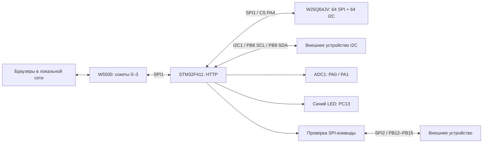

# Архитектура автономного стенда

## Четыре соединения

Каждый сокет 0–3 слушает TCP 5025 и получает по 2 Кбайт RX/TX.
У каждого HTTP-клиента собственные буферы запроса, JSON/заголовка ответа,
тайм-ауты и смещение передаваемой страницы. Обход начинается с меняющегося
номера сокета, чтобы порядок обслуживания был справедливым.

Передача идёт порциями до 1024 байт: поставить SEND, вернуться в главный цикл,
позднее проверить SEND_OK. Нет блокирующего ожидания сетевого подтверждения.
Неполный запрос закрывается через 2 с; отдельная отправка ожидает SEND_OK
до 1 с, отсутствие прогресса соединения ограничено 2 с. Обрыв клиента
закрывает его сокет; SPI-ошибка связи с W5500 требует общей повторной инициализации.

После ответа сервер закрывает TCP. Четыре сокета ограничивают число соединений,
а не число физических компьютеров. Команды LED/SPI общие для всех пользователей.

## HTTP

| Метод и адрес | Назначение |
| --- | --- |
| GET / | Страница во Flash |
| GET /api/adc | ADC, состояние LED, uptime и Ethernet speed |
| GET /api/diagnostics | Снимок W5500 и счётчики драйвера |
| POST /api/led/on | Включить LED |
| POST /api/led/off | Выключить LED |
| POST /api/spi/config | Применить CPOL/CPHA/LSB/CS без передачи данных |
| POST /api/spi | Транзакция SPI2 и ответ TX/RX |
| POST /api/i2c | Запись / чтение / repeated START по I2C1 |
| GET /api/commands | Состояние Flash, четыре текста и общие параметры |
| POST /api/commands | Сохранить снимок без передачи по SPI2 |
| GET /api/library | Первые восемь слотов каталога |
| POST /api/library | Страницы каталога, загрузка, сохранение и удаление набора |
| GET /api/rtc | Состояние и календарь RTC / LSE |
| POST /api/rtc | Явно установить дату и время |

Размер запроса с заголовком и телом ограничен 4096 байтами.
У каждого клиента свой буфер ответа 8192 байта для четырёх сохранённых команд.
SPI-тело принимается полностью по Content-Length до запуска транзакции.
POST-команды требуют X-Device-Control: 1. Chunked, конвейер запросов,
удержание соединения и повтор команд не поддерживаются.

Состояние выполнения команды не привязано к отправке ACK: после постановки
ответа SPI/LED повторно не выполняются. Ошибка доставки ответа не означает,
что команда не исполнилась.

## Шины консоли

I2C1 — отдельный аппаратный контроллер, PB8/PB9 AF4 open-drain. Каждый запрос
проверяется целиком, затем выполняется один раз. NACK, BUSY, BERR, ARLO и
общий тайм-аут 100 мс возвращаются явно; повторов нет. Последние 1/2/3 байта
принимаются с ACK/POS/BTF; короткие критические участки не включают ожидание.
[Подробности I2C](I2C_CONSOLE.md).

Браузер показывает SPI либо I2C с отдельными черновиками. Очередь фиксирует
endpoint и параметры при нажатии; смена шины до опустошения очереди заблокирована.
Запросы клиентов исполняются последовательно; SPI2 восстанавливает HSI перед I2C.

## Две SPI

SPI1 обслуживает W5500 (CS PA15) и W25Q64JV (CS PA4): PA5/PA6/PA7.
SPI2 обслуживает внешний стенд: PB13/PB14/PB15, CS PB12.
На каждый SPI-запрос устанавливаются отдельные CPOL/CPHA, частота, MSB/LSB и CS.
Команда выполняется целиком, без чередования байтов разных клиентов.
SPI2 использует DMA1 Stream 3 RX / Stream 4 TX, channel 0, 8 бит.
Тайм-аут по DWT: расчётное время пакета плюс 100 мкс; остановка DMA
ограничена отдельными 100 мкс. Сервер синхронно ждёт пакет. Частоты 2…24 МГц задаются с шагом 2 МГц, также доступны 25 МГц;
для части частот временно включается PLL, затем восстанавливается HSI 16 МГц.
Обмен SPI1 не выполняется при изменённых частотах; его режим остаётся прежним.

`command_store.c` хранит 64 набора SPI и 64 I2C по четыре текста с общими
параметрами в последнем 1 Мбайт W25Q64JV, по два сектора на набор. Начальное
чтение каталога и запись с CRC32, проверкой чтением и последним словом commit
идут кооперативно через `command_store_poll()`. API: `/api/library` и
`/api/commands`. [Формат и миграция](COMMAND_LIBRARY_DESIGN.md).

`rtc.c` запускает LSE кооперативно через `rtc_poll()`. Календарь хранится в RTC,
признак установки — в BKP0R/BKP1R. Системный сброс не сбрасывает часы.
Состояние RTC входит в ADC JSON; запись возможна только отдельным POST.
Подробности: [RTC.md](RTC.md).

[Распиновка](../firmware/PINOUT.md) · [SPI-консоль](SPI_CONSOLE.md) ·
[Диагностика](DIAGNOSTICS.md)

## Проверки

Базовые ADC/LED подтверждены пользователем на железе.
Новая многоклиентность проверена на программном транспорте четырёх соединений:
неполный запрос и задержка SEND_OK одного клиента не останавливают другие.
Проверены раздельные ответы, тайм-ауты и однократное выполнение SPI.
Сигналы SPI2, четыре реальных браузера и электрические параметры ещё нужно
проверить на плате.

## Системные параметры

settings.c валидирует IPv4 и хранит активный сетевой снимок; command_store.c
сериализует отдельные системные записи в 0x6FE000/0x6FF000 вместе с заданиями
библиотеки, не меняя 64+64 места. main сначала читает системные параметры,
затем запускает W5500; изменение сети требует отдельного apply после commit.
RTC calibration запрашивается при новом поколении, а применяется rtc_poll
без блокирующего ожидания RECALPF. GET /api/settings читает состояние; POST /api/settings и POST
/api/settings/apply требуют X-Device-Control и точный Content-Length.
