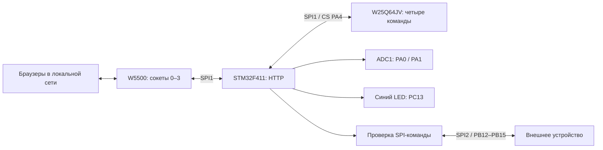

# Архитектура автономного стенда

## Четыре соединения

Каждый сокет 0–3 слушает TCP 5025 и получает по 2 Кбайт RX/TX.
У каждого HTTP-клиента собственные буферы запроса, JSON/заголовка ответа,
тайм-ауты и смещение передаваемой страницы. Обход начинается с меняющегося
номера сокета, чтобы порядок обслуживания был справедливым.

Передача идёт порциями до 1024 байт: поставить SEND, вернуться в главный цикл,
позднее проверить SEND_OK. Нет блокирующего ожидания сетевого подтверждения.
Неполный запрос закрывается через 2 с; отдельная отправка ожидает SEND_OK
до 1 с, отсутствие прогресса соединения ограничено 2 с. Обрыв клиента
закрывает его сокет; SPI-ошибка связи с W5500 требует общей повторной инициализации.

После ответа сервер закрывает TCP. Четыре сокета ограничивают число соединений,
а не число физических компьютеров. Команды LED/SPI общие для всех пользователей.

## HTTP

| Метод и адрес | Назначение |
| --- | --- |
| GET / | Страница во Flash |
| GET /api/adc | ADC, состояние LED, uptime и Ethernet speed |
| GET /api/diagnostics | Снимок W5500 и счётчики драйвера |
| POST /api/led/on | Включить LED |
| POST /api/led/off | Выключить LED |
| POST /api/spi | Транзакция SPI2 и ответ TX/RX |
| GET /api/commands | Состояние Flash, четыре текста и общие параметры |
| POST /api/commands | Сохранить снимок без передачи по SPI2 |

Размер запроса с заголовком и телом ограничен 4096 байтами.
У каждого клиента свой буфер ответа 8192 байта для четырёх сохранённых команд.
SPI-тело принимается полностью по Content-Length до запуска транзакции.
POST-команды требуют X-Device-Control: 1. Chunked, конвейер запросов,
удержание соединения и повтор команд не поддерживаются.

Состояние выполнения команды не привязано к отправке ACK: после постановки
ответа SPI/LED повторно не выполняются. Ошибка доставки ответа не означает,
что команда не исполнилась.

## Две SPI

SPI1 обслуживает W5500 (CS PA15) и W25Q64JV (CS PA4): PA5/PA6/PA7.
SPI2 обслуживает внешний стенд: PB13/PB14/PB15, CS PB12.
На каждый SPI-запрос устанавливаются отдельные CPOL/CPHA, частота, MSB/LSB и CS.
Команда выполняется целиком, без чередования байтов разных клиентов.
Тайм-аут SPI2 — 100 мс; медленная/неисправная периферия может на это время
увеличить задержку основного цикла. Частоты 2…20 МГц задаются с шагом 2 МГц;
для части частот временно включается PLL, затем восстанавливается HSI 16 МГц.
Обмен SPI1 не выполняется при изменённых частотах; его режим остаётся прежним.

`command_store.c` хранит четыре текста и общие параметры в двух последних
секторах W25Q64JV. Запись с CRC32, проверкой чтением и последним словом commit
идёт кооперативно через `command_store_poll()`. API: GET/POST `/api/commands`.

[Распиновка](../firmware/PINOUT.md) · [SPI-консоль](SPI_CONSOLE.md) ·
[Диагностика](DIAGNOSTICS.md)

## Проверки

Базовые ADC/LED подтверждены пользователем на железе.
Новая многоклиентность проверена на программном транспорте четырёх соединений:
неполный запрос и задержка SEND_OK одного клиента не останавливают другие.
Проверены раздельные ответы, тайм-ауты и однократное выполнение SPI.
Сигналы SPI2, четыре реальных браузера и электрические параметры ещё нужно
проверить на плате.
